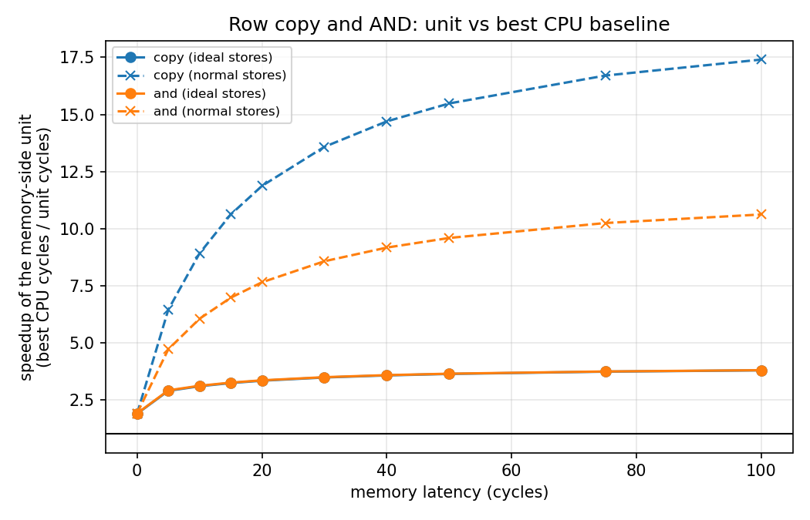
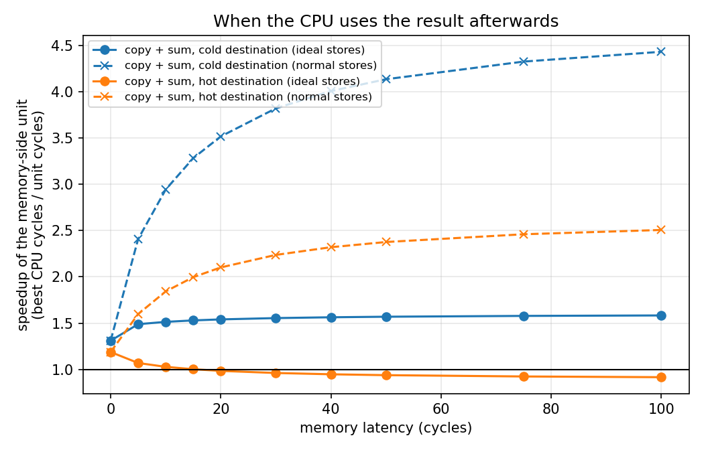
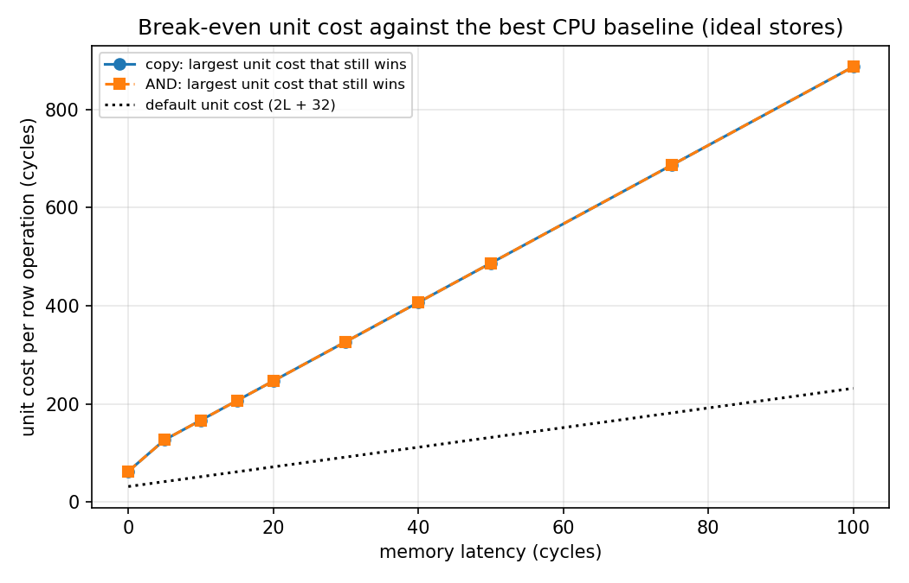

# riscv-core: a RISC-V core with a memory-side row unit

A small RISC-V (RV32I subset) processor written in Verilog from scratch, extended
with a memory-side unit that copies and ANDs whole rows of memory without the data
passing through the core. The project measures when that unit pays off compared with
the best CPU code I could write, and where it does not.

Everything is simulation (Icarus Verilog). All numbers are cycle counts from the RTL
simulation and can be reproduced with `make` and `make eval`.

## Research question

When does moving a bulk memory operation (copy, bitwise AND) out of the CPU and into a
memory-side unit pay off, and how does that depend on memory latency, the cache in
front of the core, and what the program does with the result?

Computing near memory is well established in the processing-in-memory literature, so
this project does not claim a new idea. It is a small, reproducible evaluation on a
core built from scratch, with attention to how fair the baselines are.

## Main findings

Within the model described below. Speedup = best CPU cycles / unit cycles. The best CPU
is hand-unrolled code with the faster of cache off and cache on, and an ideal store
buffer (stores never wait), which is the strongest CPU baseline in this project.

1. **Copying or ANDing one 32-word row:** the unit is 1.9x faster at memory latency 0,
   3.6x at latency 50 and 3.8x at latency 100.
2. **When the CPU reads the result afterwards**, the gain shrinks to 1.3x - 1.6x,
   because the CPU still has to fetch the data it did not copy.
3. **When the destination row is already in the cache, the unit loses** above about 15
   cycles of latency (0.94x at latency 50). The CPU's stores keep the cached copy
   up to date, while the unit invalidates it and the CPU has to fetch it again.
4. **The choice of baseline moves the result more than the hardware does.** Against a
   naive copy loop at latency 0 the unit looks 5.6x faster, and against a CPU with no
   store buffer the copy speedup reaches 17x at latency 100. Against the best CPU
   baseline it is 1.9x - 3.8x.
5. **Break-even:** at latency 50, the unit stays ahead of the best CPU as long as one
   row operation costs fewer than 487 cycles (default cost: 132). At latency 0 the
   limit is 63 cycles (default: 32).

## What is built

- **Core:** single-cycle RV32I subset: add, sub, and, or, xor, shifts, slt/sltu (register
  and immediate forms), lw, sw, beq, bne. Not implemented: lui, auipc, jal, jalr,
  blt/bge and variants, byte and halfword accesses.
- **Memory:** 1 KB instruction memory (never waits) and 1 KB data memory with a
  configurable latency. While a load or store waits, the whole CPU freezes.
- **Data cache:** direct-mapped, 16 lines of 4 words (256 bytes), write-through, no
  write-allocate. A load hit does not wait. A load miss waits `latency + 3` cycles
  (the first word with the latency, then one word per cycle) and installs the line.
- **Store modes:** normal (a store waits `latency` cycles) and ideal (stores never
  wait), which models a store buffer that never fills and bounds the best case for
  the CPU. A real store buffer lies between the two.
- **Memory-side unit:** works on rows of 32 words (128 bytes). Two instructions in the
  RISC-V custom-0 opcode space: `pim_copy rs1, rs2` copies the row containing the
  address in rs2 to the row containing the address in rs1, and `pim_and rs1, rs2`
  does `row[rs1] &= row[rs2]`. The row operation takes place inside the data memory.
  It blocks the CPU for `unit_cycles` cycles (default `2 * latency + 32`: read a row,
  stream 32 words, write a row) and invalidates the cached lines of the destination
  row.

With these rules, `cycles = instructions + stall cycles` holds exactly, and so do the
per-benchmark formulas below.

## Method

**Benchmarks** (32-word rows: array A at 0x100, B at 0x180, C at 0x200 for copy and
AND; the consumer benchmarks copy row 2 into row 3, at 0x180):

| Name | What it does |
|---|---|
| `copy`, `and` | naive CPU loops (reference only) |
| `copy_unrolled`, `and_unrolled` | fully unrolled CPU code: the best CPU baseline |
| `pim_copy`, `pim_and` | the same work using the unit (AND takes two operations, copy then in-place AND) |
| `cons_cpu`, `cons_pim` | copy a row, then the CPU sums the destination ("cold" destination) |
| `hot_cpu`, `hot_pim` | the CPU first sums the destination so it is cached, then copy, then sum again ("hot" destination) |

Each benchmark is run with the cache off and on, in both store modes, at latencies
0 to 100, and every run verifies its own result (copy compared with the source, AND
recomputed word by word, consumer sum compared with the expected value). A run that
fails verification stops the sweep, so a broken benchmark can never produce numbers.

**Cycle formulas** (ideal stores, L = memory latency). Each was derived by hand from
the model before the simulation was run, and `check_formulas.py` verifies all of them
against every row of `results/results.csv`:

| Benchmark | CPU, cache off | CPU, cache on | Unit, cache off | Unit, cache on |
|---|---|---|---|---|
| copy | 66 + 32L | 90 + 8L | 35 + 2L | 35 + 2L |
| AND | 131 + 64L | 179 + 16L | 69 + 4L | 69 + 4L |
| copy + sum, cold | 131 + 64L | 179 + 16L | 100 + 34L | 124 + 10L |
| copy + sum, hot | 196 + 96L | 244 + 16L | 165 + 66L | 213 + 18L |

The "best CPU" and "unit" columns of the results table take, for each system, the
smaller of its cache-off and cache-on cycles. At L = 0 the cache-off version is
faster (a cache only adds the line-fill cost when there is no latency to hide), so the
L = 0 column follows the cache-off formulas. From L = 1 on, the cache-on formulas give
the best value (several tie at L = 1). The copy and AND unit benchmarks load nothing,
so the cache does not change them.

As latency grows, the speedups approach 4x (copy and AND), 1.6x (cold) and 0.89x
(hot): the ratios of the cache-on L coefficients (8/2, 16/4, 16/10, 16/18).

## Results

Best CPU cycles / unit cycles (speedup), ideal stores. The full data is in
`results/results.csv` and the table below is `results/summary.txt`.

| Scenario | L = 0 | L = 10 | L = 50 | L = 100 |
|---|---|---|---|---|
| copy | 66 / 35 (1.89x) | 170 / 55 (3.09x) | 490 / 135 (3.63x) | 890 / 235 (3.79x) |
| AND | 131 / 69 (1.90x) | 339 / 109 (3.11x) | 979 / 269 (3.64x) | 1779 / 469 (3.79x) |
| copy + sum, cold | 131 / 100 (1.31x) | 339 / 224 (1.51x) | 979 / 624 (1.57x) | 1779 / 1124 (1.58x) |
| copy + sum, hot | 196 / 165 (1.19x) | 404 / 393 (1.03x) | 1044 / 1113 (0.94x) | 1844 / 2013 (0.92x) |
At L = 0 the cache-off versions are the faster ones; from L = 1 on, the cache-on
versions are (see the formulas above).

The dashed curves in the first two figures use normal stores (a CPU with no store
buffer). There the unit wins by much more, including in the hot-destination case, so
the loss in finding 3 exists only against a CPU with a very good store buffer.

## Verification

- Unit testbenches for the ALU, register file, decoder, cache and the memory row
  operation (`make`).
- Six self-checking assembly programs, each run in 12 configurations (cache off/on,
  store mode, latency 0/3/10): 72 runs (`make tests`). Two of the programs are written
  to expose specific bugs: a load whose destination register is also its address
  register, and a stale cached line after a row operation. That second test failed
  first and was then fixed by invalidating the destination row.
- Mutation testing: each component was deliberately broken to check that a test fails.
  This found real weaknesses in the tests. For example, an early row-AND test used two
  rows whose AND equals one of the inputs, so a unit whose AND did nothing would have
  passed.
- Every cycle count was predicted by hand before running it.

## Limitations

- **The unit cost is an assumption.** `2L + 32` is my modelling choice, not a
  measurement of any hardware. That is why the results include the break-even cost.
  `+unit_cycles=N` overrides it.
- **The memory model is a single latency number.** There are no DRAM banks, row
  buffers or bandwidth limits, and instruction fetch is ideal. Calibrating against a
  cycle-accurate DRAM simulator such as Ramulator2 would be the natural next step.
- **The unit moves more data per memory latency than the cache does** (128 bytes against
  16). That is partly a real advantage of working inside memory and partly a modelling
  choice, and a CPU with 128-byte cache lines would narrow the gap. This was not
  simulated.
- **The unit blocks the CPU.** There is no overlap of CPU work with the unit, which is
  conservative for the unit.
- **Only one row size and two operations** were measured, with a 1 KB data memory. 
  I expect both sides to scale roughly linearly with the number of rows, but did not
  test it, so no data-size sweep is included.
- **The cache invalidation policy is where the unit loses.** If the unit updated the
  cache instead, the hot-destination case would take about 189 + 10L cycles against
  the CPU's 244 + 16L. That is extrapolated from the formulas and not simulated.
- **The baselines are hand-written assembly.** There is no compiler. The naive loops
  are included to show how much the baseline matters.
- **The design is behavioural.** The row operation updates 32 words in one clock edge
  inside the memory model, so it is not synthesizable as written, and there are no
  area or frequency results.

## Reproducing

Requirements: Icarus Verilog (`iverilog`, `vvp`), GNU make, python3 with matplotlib,
and the RISC-V binutils:

    sudo apt install iverilog make python3-matplotlib binutils-riscv64-unknown-elf

    make          # unit testbenches and the 72 CPU test runs
    make eval     # 400 benchmark runs -> results/results.csv, figures, summary table

One run by hand:

    sw/asm2hex.sh sw/bench_pim_copy.s
    vvp sim/cpu_tb +prog=sw/bench_pim_copy.hex +data=sw/data_copy32.hex +verify_copy \
        +latency=50 +cache=1 +ideal_store=1

Options: `+prog=FILE`, `+data=FILE`, `+latency=N`, `+cache=0|1`, `+ideal_store=0|1`,
`+unit_cycles=N`, `+fill_extra=N` (default 3), and `+verify_copy`, `+verify_and` or
`+verify_sum` for benchmarks. `sw/gen_consumer.sh` regenerates the four consumer
benchmarks.

## Layout

- `rtl/` Verilog design: alu, regfile, decoder, imem, dmem (with the row operation),
  cache, cpu
- `tb/` testbenches
- `sw/` assembly tests and benchmarks, data files, assembler script, `pim.inc`
- `results/` CSV, figures and summary table produced by `make eval`
- `run_tests.sh`, `run_bench.sh`, `run_sweep.sh`, `plot_results.py`, `check_formulas.py` scripts

## Future work

Write-allocate and wider cache lines; updating the cache instead of invalidating it;
overlapping unit and CPU work; a data-size sweep; a 5-stage pipeline and branch
predictor; calibration against a DRAM simulator; synthesis for area and frequency.
